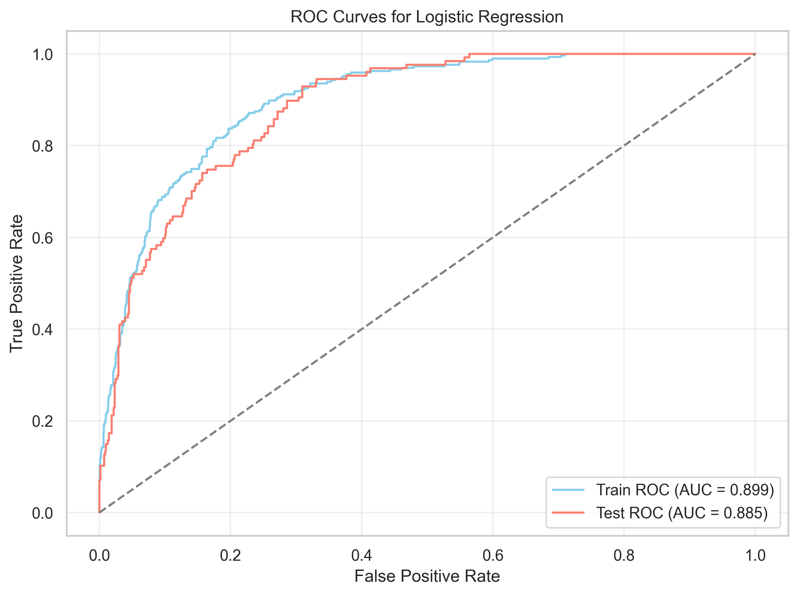
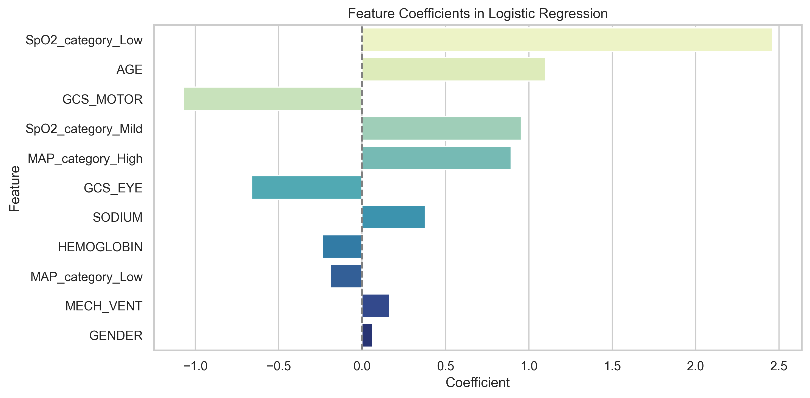

# Predicting In-Hospital Mortality in Traumatic Brain Injury Patients

Weighted ridge logistic regression model that predicts in-hospital mortality in adult ICU patients with Traumatic Brain Injury (TBI), using routinely collected data from the first 24 hours of ICU admission in the MIMIC-III database.

Group project for the Electronic Health Records course of the MSc in Health Data Science (MHEDAS), Universitat Rovira i Virgili.

## Overview

Early risk assessment in ICU patients with traumatic brain injury is difficult, and established prognostic models rely on admission characteristics and imaging that may not be available early in the ICU stay. This project asks whether routinely collected ICU data from the first 24 hours is enough to estimate the risk of dying in hospital.

The cohort contains 2716 adult patients (422 deaths, 15.5% mortality), identified with ICD-9 codes. The predictors are demographics, neurological scores, vital signs, laboratory values and ventilation status. The model is interpretable by design, so each predictor's contribution to the risk can be read from its coefficient.

## Results

The data is not public (see [Data](#data)). The table shows performance for the mortality class, with stratified 5-fold cross-validation on the training set and on a held-out test set (30%).

| Set | Accuracy | Precision | Recall | F1 | AUC |
|-----|----------|-----------|--------|----|-----|
| Cross-validation (train) | 0.805 | 0.432 | 0.800 | 0.560 | 0.893 |
| Held-out test | 0.860 | 0.549 | 0.575 | 0.562 | 0.885 |

Key findings:

- The model discriminates well on unseen patients (test AUC 0.885), with a decision threshold of 0.74 tuned to maximize F1 for the mortality class.
- Low oxygen saturation, advanced age and poor neurological scores (Glasgow Coma Scale, motor and eye components) are the strongest predictors.
- Blood pressure, hemoglobin, sodium and mechanical ventilation add smaller contributions.





## Data

The cohort comes from MIMIC-III v1.4. This repository contains no data, because the MIMIC-III data use agreement does not allow the data or datasets derived from it to be shared publicly. Access requires credentialed approval on PhysioNet. See [`data/README.md`](data/README.md) for how to get access and how the dataset is built.

## Methods

1. **Cohort selection:** adults (18 years or older) with a TBI-related ICD-9 code (800 to 804 and 850 to 854), one ICU admission per patient.
2. **Feature extraction:** SQL queries (PostgreSQL, run through DBeaver) extract first-24-hour data: age, sex, Glasgow Coma Scale components, mean arterial pressure, oxygen saturation, sodium, hemoglobin and mechanical ventilation.
3. **Preprocessing:** plausibility ranges for clinical variables, imputation depending on the share of missing values (median, KNN or mean), winsorization of blood pressure, standardization, and removal of variables with excessive missingness (verbal GCS and glucose).
4. **Model:** weighted logistic regression with L2 (ridge) regularization to handle class imbalance, with multicollinearity checked through the variance inflation factor and sample size through events per variable.
5. **Evaluation:** 70/30 train-test split, stratified 5-fold cross-validation, threshold optimization, and accuracy, precision, recall, F1 and AUC.

The full methodology, results and discussion are in [`docs/tbi_mortality_report.pdf`](docs/tbi_mortality_report.pdf). 

## Repository structure

```
.
├── data/                
├── docs/
│   ├── presentation.pdf
│   ├── supplementary_figures.pdf 
│   ├── supplementary_methods.pdf
│   └── tbi_mortality_report.pdf
├── figures/ 
├── notebooks/ 
│   └── tbi_mortality_prediction.ipynb      
├── README.md
└── requirements.txt
```

## How to run

The analysis needs the MIMIC-III database, which is not public (see [`data/README.md`](data/README.md)).

1. Get credentialed access to MIMIC-III and load it into PostgreSQL.
2. Run the SQL in the first section of the notebook and export the result as CSV into `data/`.
3. Install the dependencies and open the notebook:

```bash
git clone https://github.com/cindychenqiu/tbi-mortality-prediction.git
cd tbi-mortality-prediction
python -m venv .venv
source .venv\Scripts\activate # on macOS/Linux .venv/bin/activate 
pip install -r requirements.txt
jupyter notebook notebooks/tbi_mortality_prediction.ipynb
```

Tested with Python 3.12.

## Limitations and next steps

- **Single-center, retrospective data:** causal relationships cannot be established, and external validation in other hospitals is needed before any clinical use.
- **Missing clinical information:** pre-hospital severity, imaging, comorbidities and neurosurgical interventions were not available, and some variables were dropped for excessive missingness.
- **Short-term outcome only:** the model predicts in-hospital mortality and should not be used for long-term prognosis.
- **Static summaries:** using aggregate values of the first 24 hours hides temporal trends, so longitudinal models are a next step, along with comparisons with elastic net and tree-based models.

## Authors and acknowledgements

Group project by Keith Megara Osores Vicuña, Ema Stangova and Cindy Chen.    
  
[LinkedIn](https://www.linkedin.com/in/cindychenqiu/) | [GitHub](https://github.com/cindychenqiu)
